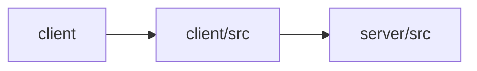

# Architecture

Otto is a multi-workflow AI content studio composed of a React/Vite frontend and an Express.js backend. The client (client/src) provides a landing page and a tab-based studio workspace exposing five features: blog writing, chat agent, summarization, translation, and caption generation. Each feature is organized under client/src/features/<feature> with a presentational component plus a dedicated hook (e.g. useBlogGenerator, useChatSession) that issues HTTP POST requests through the shared postJson utility in client/src/lib/api.ts. Shared UI primitives (Button, Card, Select, TextArea) and layout components (Navbar, Sidebar) live under client/src/components. The Vite dev server proxies /api requests to the backend on port 4000. The server (server/src) is an Express app that mounts one router per feature (blog, summarize, translate, caption, agent), all guarded by API-key auth middleware and a centralized error handler. Every endpoint calls Claude Sonnet via the Anthropic SDK, with system prompts organized under server/src/lib/prompts and a contentAgent wrapper in server/src/lib/clients.ts. The frontend feature hooks map one-to-one onto backend routes, forming the primary AI integration boundary.

## Modules

| module | summary | AI |
| --- | --- | --- |
| `client` | Vite build/dev configuration for the React client, proxying /api to the backend on port 4000. | — |
| `client/src` | React frontend with landing page and tab-based studio exposing five AI workflows via feature hooks. | — |
| `server/src` | Express API with five Claude-backed endpoints, API-key auth, and centralized error handling. | [AI] |

## Module dependencies

_`[AI]` marks modules with AI/LLM touchpoints (prompt files, model API calls, agent logic)._
