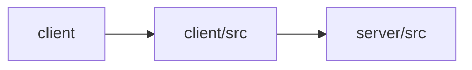

# Architecture

Otto is a full-stack AI content studio consisting of a React (Vite) client and an Express (TypeScript) server. The client presents five workflows (blog writing, chat, summarizing, translation, captioning) in a tab-based Studio shell, with each workflow implemented as a self-contained feature folder pairing a presentational component with a custom hook that calls the backend. A shared HTTP client (lib/api.ts) issues POST requests to the server's /api endpoints. The server mounts one router per workflow, guards all routes with API-key middleware, and delegates to Anthropic's Claude models via an Anthropic SDK client plus the ai-sdk provider; prompts are centralized under lib/prompts. Errors are handled by a global error middleware. The typical data flow is: feature component -> feature hook -> lib/api -> Express route -> Anthropic client (with a system prompt) -> response back to the hook's local state.

## Modules

| module | summary | AI |
| --- | --- | --- |
| `client` | Vite build and dev-server configuration with API proxy to the backend. | — |
| `client/src` | React frontend with tab-based Studio shell and five feature workflows, each pairing a component with an AI-calling hook. | — |
| `server/src` | Express API exposing per-workflow endpoints backed by Anthropic Claude, with API-key auth and global error handling. | [AI] |

## Module dependencies

_`[AI]` marks modules with AI/LLM touchpoints (prompt files, model API calls, agent logic)._
